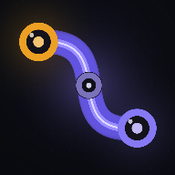

# ComfyUI Workflow Studio

> 面向入门的可视化 AI 工作流实验室。用拖拽节点、连接端口、填写参数和点击执行，理解 ComfyUI / 节点式 AI 工作流的核心概念。



这是一个真正可交互的节点编辑器，不是静态设计稿。项目同时包含 Web、iOS（Xcode 工程）和 Android（Android Studio 工程）。

## 这个 App 适合学什么

- 节点（Node）、连接（Edge）、端口（Port）和数据类型
- 有向无环图（DAG）与执行顺序
- 提示词、负向提示词、随机种子、画幅尺寸
- Checkpoint、LoRA、Latent、采样器等 ComfyUI 常见概念
- 模拟执行与真实 API 执行的区别
- 如何用 Agnes 与 DeepSeek 完成一次真实的「文本 → 图像」流程

打开 App 后，右侧「工作流概览」底部或「帮助」中都有学习中心，包含 6 个可勾选的入门练习、核心概念卡片和快捷键说明。

## 已实现功能

### 编辑器

- 深色专业桌面布局：顶部工具栏、节点库、无限画布、属性面板、执行状态栏
- 23 个可扩展节点，覆盖 11 个分类，支持搜索、分类折叠、收藏和最近使用
- 画布平移、滚轮缩放、框选/多选、节点拖拽、复制粘贴、删除、分组
- 左/中/右/上/下对齐与分布、按依赖自动排列、全览
- 贝塞尔曲线连接，端口按数据类型着色
- 连接时检查类型、必填端口、重复连接与循环依赖
- 连接可拖动端点重新连接，可删除
- 撤销/重做、自动保存、JSON 导入/导出、工作流库、另存为、重命名、复制、删除
- 节点右键菜单、属性实时同步、图片上传与本地 Canvas 处理

### 执行

- 预检：未知节点、断边、端口不匹配、重复连接、环检测、缺失必填输入
- 拓扑排序后按依赖执行，显示当前节点、进度、成功/失败状态
- 执行日志、执行历史、失败节点自动定位
- 单节点执行、从指定节点继续执行、节点结果缓存
- 模拟模式与真实模式有明确标识，模拟图片带 `SIMULATION` 水印
- 真实 API：Agnes 文生图/图生图、DeepSeek 提示词优化
- 可选 ComfyUI API 工作流节点：提交任务、WebSocket 进度监听、轮询 history

### 学习与可用性

- 学习中心、术语解释、6 个入门练习和进度保存
- 所有关键操作有 Toast 反馈；错误可回溯到节点
- 移动端适配：抽屉式节点库/属性面板、底部导航、安全区适配
- iOS + Android 原生工程、应用图标和启动屏
- API Key 只保存在本机，不写入源码，不上传到项目服务器

## 快速开始（Web）

环境：

- Node.js **20+**
- npm 10+

```bash
npm install
npm run dev
# 打开终端输出的地址，例如 http://localhost:5173
```

生产构建：

```bash
npm run build
npm run preview
```

Web 端直连 Agnes / DeepSeek 可能遇到浏览器 CORS 限制。生产 Web 版本建议启动 `server/` 的 FastAPI 代理并在设置中开启「通过后端代理 API」。iOS / Android 原生 WebView 已启用 `CapacitorHttp`，通常可以直接请求。

## 在 App 里填写 API Key

打开 **设置 → API 接入**：

- **Agnes API Key**：用于「Agnes 图像生成」节点
- **DeepSeek API Key**：用于「DeepSeek 提示词优化」节点
- **ComfyUI 地址**（可选）：用于自定义 ComfyUI API 工作流节点
- **FastAPI 后端**（可选）：解决 Web CORS，或自行扩展服务

默认执行模式是「自动」：

- 有 Key → 调用真实 API
- 没有 Key → 明确标注的模拟执行，不会假装生成了真实图片

> **安全提醒**：API Key 保存在设备的 IndexedDB / localStorage 中，仅适合个人学习和试用。不要提交 `.env`、密钥或 GitHub token 到仓库；本仓库是公开仓库，任何人的 Key 都不应写进源码。正式产品请把密钥放到服务端，并通过鉴权后的后端代理调用。

## iOS 工程

`ios/` 是完整的 Capacitor Xcode 工程，包含应用图标、启动屏、本地网络权限和照片访问说明。

```bash
npm install
npm run ios:sync     # 构建 Web 并同步到 iOS 工程
npx cap open ios     # 在 Mac 的 Xcode 中打开
```

在 Xcode 中选择签名 Team 和真机/模拟器后运行。

- 在 Mac 上使用 Xcode 签名后可以安装到 iPhone。
- 要导出 IPA / 上 TestFlight / App Store，需要 Apple Developer Program 账号。
- **无法在 Windows/Linux 上编译 iOS 二进制**，这是 Apple 工具链限制，不是项目缺少文件。

详细步骤见 [docs/IOS_BUILD.md](docs/IOS_BUILD.md)。

## Android 工程

`android/` 是完整的 Capacitor Android 工程，包含自适应图标、启动屏和局域网 HTTP 支持。

```bash
npm install
npm run android:sync       # 构建 Web 并同步到 Android 工程
npx cap open android       # 用 Android Studio 打开
# 或
npm run android:build      # 需要本机安装 JDK 21 + Android SDK 36
```

Debug APK 输出：

```
android/app/build/outputs/apk/debug/app-debug.apk
```

详细步骤见 [docs/ANDROID_BUILD.md](docs/ANDROID_BUILD.md)。

## 可选 FastAPI 后端

```bash
cd server
python3 -m venv .venv
source .venv/bin/activate      # Windows: .venv\Scripts\activate
pip install -r requirements.txt
uvicorn main:app --host 0.0.0.0 --port 8000
```

回 App 设置填写 `http://<电脑局域网 IP>:8000`，打开「通过后端代理 API」。

接口：

- `GET /api/health`
- `GET /api/workflows` / `GET /api/workflows/{id}`
- `PUT /api/workflows/{id}` / `DELETE /api/workflows/{id}`
- `POST /api/ai/agnes`、`POST /api/ai/agnes/check`
- `POST /api/ai/deepseek`
- `POST /api/comfy/health`

后端使用 SQLite 保存工作流，代理 AI 请求时不落盘 API Key。生产环境请自行加鉴权、速率限制并把 CORS 限制到你的域名。

## 工作流 JSON

导出的文件示例（节选）：

```json
{
  "schemaVersion": 1,
  "app": "comfyui-workflow-studio",
  "version": "1.0.0",
  "id": "wf_xxx",
  "name": "Aurora / 电影感宇航员",
  "nodes": [
    {
      "id": "node_xxx",
      "type": "studio",
      "position": { "x": 0, "y": 20 },
      "data": {
        "defType": "prompt",
        "label": "提示词",
        "params": { "text": "A cinematic portrait…", "template": "custom" }
      }
    }
  ],
  "edges": [
    {
      "id": "edge_xxx",
      "source": "node_xxx",
      "target": "node_yyy",
      "sourceHandle": "text",
      "targetHandle": "prompt",
      "type": "studioEdge",
      "data": { "dataType": "TEXT", "sourcePort": "text", "targetPort": "prompt" }
    }
  ]
}
```

数据包含节点 ID、类型、位置、参数、父分组、连接关系和版本信息；不包含运行结果与 API Key。

## 目录结构

```
.
├── src/                    Web 前端（React + TypeScript）
│   ├── components/         编辑器 UI、节点、连线、面板、弹窗
│   ├── lib/                节点注册表、图算法、执行引擎、API、存储
│   ├── store/              Zustand 全局状态
│   ├── data/               示例工作流
│   ├── styles/             设计令牌与完整样式
│   └── types/              类型定义
├── ios/                    Capacitor iOS Xcode 工程
├── android/                Capacitor Android 工程
├── server/                 FastAPI + SQLite 可选后端
├── public/                 PWA manifest、图标、品牌矢量图
├── scripts/                图标与启动屏生成脚本
├── docs/                   iOS / Android / 架构文档
├── capacitor.config.json
├── vite.config.ts
└── package.json
```

## 常用命令

| 命令 | 作用 |
| --- | --- |
| `npm run dev` | 开发服务器 |
| `npm run build` | 类型检查 + 生产构建 |
| `npm run icons` | 重新生成 iOS / Android / PWA 图标与启动屏 |
| `npm run cap:sync` | 构建 Web 并同步到 iOS + Android |
| `npm run ios:sync` | 构建并同步 iOS |
| `npm run android:sync` | 构建并同步 Android |
| `npm run android:build` | 尝试构建 Debug APK（需 SDK） |

## 已知边界

- 本项目定位是**入门学习工具**，不是 ComfyUI 的完整替代品。
- `KSampler` 节点用于解释采样参数和依赖结构；真实采样请使用 ComfyUI API 工作流节点并配置服务地址。
- Agnes 官方当前支持的输出尺寸为 1024×1024、1024×768、768×1024；界面里的宽高会自动映射到最接近的受支持尺寸。
- iOS 二进制与 Android APK 不在仓库中预置，需要对应的签名工具链构建。
- 真实模型生成依赖第三方服务；本项目只负责编辑、预检、调用与结果展示。

## 开发说明

架构、节点扩展方式和执行流程见 [docs/ARCHITECTURE.md](docs/ARCHITECTURE.md)。

前端与后端没有共享数据库依赖：App 默认完全离线可用，工作流保存在本机；FastAPI 是可选增强。
